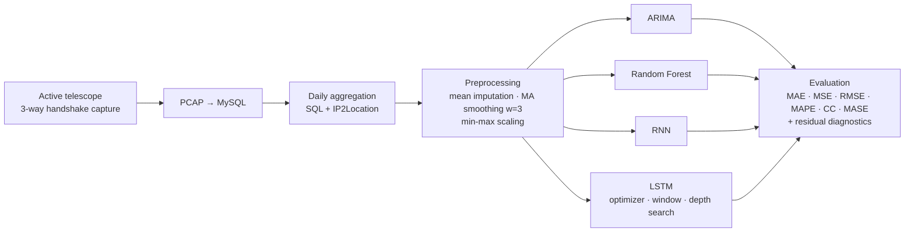
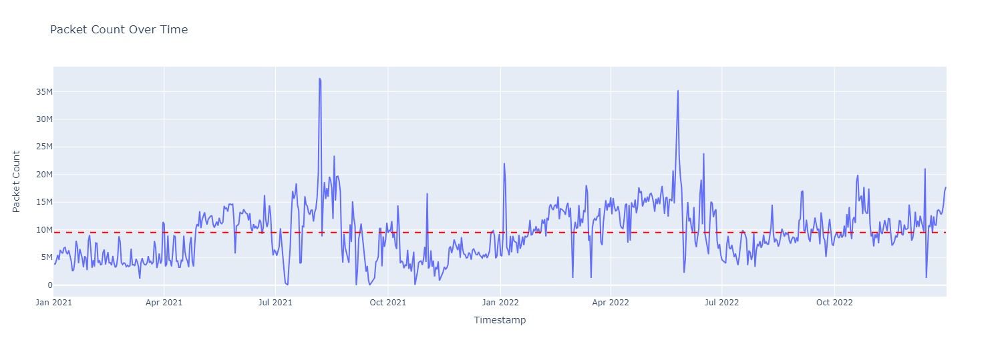
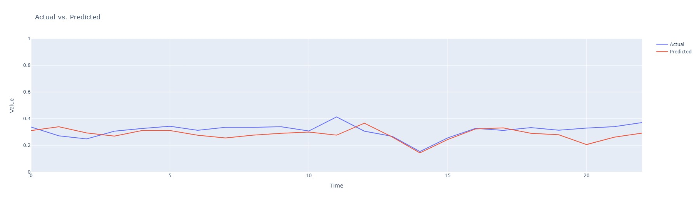

# Forecasting Internet Background Radiation from an Active Network Telescope

**A comparative study of statistical, machine learning and deep learning models (ARIMA, Random Forest, RNN, LSTM) for predicting daily unsolicited TCP traffic seen by an active network telescope.**

M.Sc. thesis, M.Sc. Data Science, PSG College of Technology (Anna University), November 2023.
Research carried out at the **CSIR Fourth Paradigm Institute (CSIR-4PI), Bengaluru**, through the CSIR SPARK research programme.

📄 **[Read the full thesis (PDF)](thesis/Sivani_U_MSc_Thesis_Network_Telescope_Forecasting.pdf)**

---

## Overview

A network telescope watches IP addresses that are routed but host no services. Any traffic reaching them is unsolicited: scanning, probing, botnet propagation, misconfiguration. This traffic is known as **Internet Background Radiation (IBR)**. It looks like noise, but it carries early signals of large-scale malicious activity.

Most prior work studies IBR with *passive* telescopes and focuses on classifying traffic. This thesis asks a forecasting question instead:

> **Can the daily volume of IBR TCP traffic at a small-aperture *active* network telescope be predicted ahead of time, and which family of models does it best?**

Being able to forecast the expected arrival rate turns the telescope from a passive record into a baseline against which unusual surges can be flagged.

## Why an *active* telescope matters

The CSIR-4PI telescope does not just record packets. It completes the TCP three-way handshake (SYN → SYN-ACK → ACK) with each incoming connection. Only connections that finish the handshake enter the dataset, so **spoofed source addresses and DDoS backscatter are filtered out**. That makes the data a cleaner signal of real scanning sources than a passive darknet gives.

## Pipeline



## Data

- **Source:** the CSIR-4PI active network telescope. Packets are captured as PCAP, parsed and stored in MySQL.
- **Period:** daily series from 1 January 2021 to 31 December 2022, built first from four high-traffic ports (22 SSH, 23 Telnet, 80 HTTP, 443 HTTPS) and then extended to all ports.
- **Daily features:** packet count (the target), plus counts of unique source IPs, source countries (geolocated with IP2Location), ASNs, AS organisations and proxy connections.
- **Gaps:** 16 missing days caused by operational outages (storage full, server downtime and similar), filled by mean imputation.
- **Outliers:** the large spikes are real traffic surges, not errors, so they are **kept**. They are dampened with a 3-day moving average rather than removed.


*Daily IBR packet count at the telescope, 2021 to 2022. The dashed line is the mean. The series is non-stationary and has extreme spikes reaching about 35M packets a day.*

> The raw telescope data belongs to CSIR-4PI and is not included in this repository.

## Methods

| Family | Model | What was explored |
|---|---|---|
| Statistical | **ARIMA(5,1,0)** | Residual analysis (scatter, density, ACF, Q-Q), Ljung–Box and Durbin–Watson tests |
| Machine learning | **Random Forest regressor** | Ensemble regression baseline |
| Deep learning | **Simple RNN** | Trained for 500 epochs, compared on validation and test sets |
| Deep learning | **LSTM** | Systematic search over **optimizer** (SGD + momentum, Adagrad, RMSprop, Adam), **input window** (1 to 10 days) and **depth and width** (2 to 3 layers, 16 to 64 units) |

**Final LSTM:** 3 layers (64 → 32 → 32 units), Adam optimizer, 7-day input window predicting the next day, trained for 100 epochs (chosen from the loss curve).

## Key results

All error metrics are on the min-max-normalised packet count (test set).

| Model | MAE ↓ | MSE ↓ | RMSE ↓ | CC ↑ | MASE ↓ |
|---|---|---|---|---|---|
| Random Forest | 0.0699 | 0.0076 | 0.0872 | 0.06 | 1.54 |
| RNN | 0.0789 | 0.0066 | 0.0811 | 0.50 | 1.64 |
| LSTM, Adam (optimizer study, port 443) | 0.1108 | 0.0068 | 0.0823 | 0.77 | 1.69 |
| **LSTM, 64-32-32, Adam (best)** | **0.0394** | **0.0007** | **0.0266** | **0.80** | **1.04** |

ARIMA(5,1,0) left no significant autocorrelation in the residuals (Ljung–Box test; Durbin–Watson = 1.99). However, the residuals had heavy tails and large swings, so a linear model misses the spikes.


*Final LSTM: actual vs predicted next-day packet count on held-out test data (normalised).*

### Findings

1. **The LSTM was the only model that tracked the series well.** The tuned 3-layer LSTM cut test MSE by about 10× compared with the RNN and Random Forest, and reached the highest correlation (0.80).
2. **The optimizer mattered more than expected.** With the same architecture, Adam and RMSprop converged to useful forecasts (CC ≈ 0.78). SGD with momentum and Adagrad flat-lined (CC ≈ 0.07 and −0.60).
3. **Deeper was not better.** Performance did not rise steadily with depth. A tapered 64-32-32 network beat a uniform 64-64-64 one, so architecture shape matters more than size here.
4. **Shorter horizons were more reliable.** IBR patterns drift as new scanning campaigns appear. A 7-day window predicting one day ahead was more robust than predicting 30 days out.
5. **The Simple RNN overfit.** It scored well on validation (CC 0.73) but generalised poorly to test data (CC 0.50). This is consistent with it having no gating to forget stale context.

## Limitations and future directions

These are the questions I would take further:

- **Beating persistence.** The best LSTM's MASE of about 1.04 means it roughly matches a naive "same as yesterday" forecast. Clearly beating that baseline is the real target. Likely routes are multivariate inputs (IP, ASN and country counts as covariates), attention or Transformer models, and probabilistic forecasts.
- **Concept drift.** New botnets and scanning campaigns change the distribution. Online or rolling retraining and drift detection are natural next steps.
- **From forecasting to detection.** Treating forecast residuals as an anomaly score could flag emerging campaigns in near real time.
- **Per-port and per-source modelling.** Separate forecasts for heavily targeted services (SSH, Telnet, IoT ports) may show structure that the aggregate hides.
- **Data quality.** Mean imputation and a single small-aperture sensor limit generality. Comparing against larger telescopes would test whether the findings hold up.

## Repository contents

```
.
├── README.md
├── CITATION.cff
├── thesis/
│   └── Sivani_U_MSc_Thesis_Network_Telescope_Forecasting.pdf
└── figures/
    ├── packet_count_2021_2022.png
    └── lstm_actual_vs_predicted_test.png
```

## Tools

Python · NumPy · Pandas · scikit-learn · TensorFlow / Keras · SciPy · Plotly · MySQL · Wireshark. Run on a Fedora Linux server (Intel Xeon Silver 4314, 32 cores, 64 GB RAM) and Google Colab.

## Citation

```bibtex
@mastersthesis{sivani2023telescope,
  author  = {Sivani U},
  title   = {Application of DL and ML Techniques towards a Prediction Framework of Active Network Telescope Data},
  school  = {PSG College of Technology, Anna University},
  address = {Coimbatore, India},
  year    = {2023},
  month   = {November},
  note    = {Research carried out at CSIR Fourth Paradigm Institute (CSIR-4PI), Bengaluru}
}
```

## Acknowledgements

I am grateful to **Dr. V. Anil Kumar** (Chief Scientist, CSIR-4PI and AcSIR), my research mentor. I also thank **Dr. HNV Dutt** and **Dr. Ashapurna Marndi** (CSIR-4PI) for their guidance, and **Dr. Shina Sheen** (Professor and Head, Department of Applied Mathematics and Computational Sciences, PSG College of Technology), my internal guide.

## Author

**Sivani U**, M.Sc. Data Science, PSG College of Technology. Backend engineer, interested in ML for systems and security.
📧 sivaniulax09@gmail.com · [LinkedIn](https://www.linkedin.com/in/sivani-u-09apr2003/)
